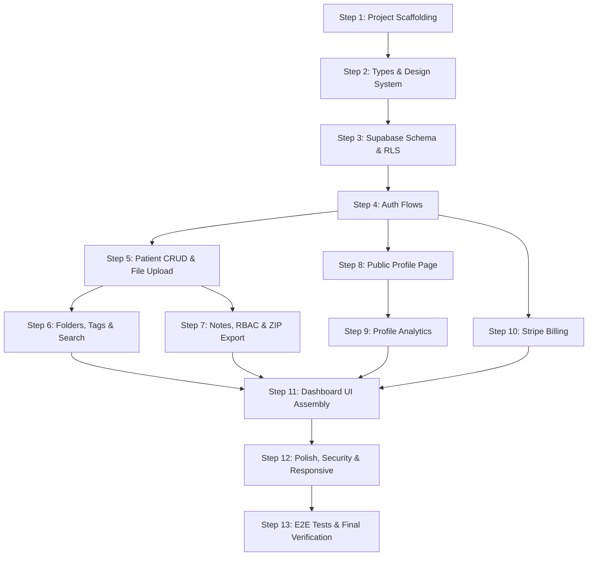

# MediLink MVP v1 — Blueprint

> **Objective:** Build MediLink — the all-in-one professional OS for independent physicians — with a private dashboard (encrypted file storage, patient notes, role-based access), public profile page, Supabase Auth, and Stripe billing.  
> **Mode:** Direct (no git/gh CI — code is edited in place, verified with local commands)  
> **Generated:** 2026-03-18

---

## Dependency Graph



### Parallelism Summary

| Serial Chain                       | Parallelizable Groups              |
| ---------------------------------- | ---------------------------------- |
| S1 → S2 → S3 → S4                 | S5 ∥ S8 ∥ S10 (after S4)          |
| S5 → S6, S5 → S7                  | S6 ∥ S7 (after S5)                |
| S8 → S9                           | S9 ∥ S11 prep (after S8)          |
| S11 → S12 → S13                   | —                                  |

---

## Step 1: Project Scaffolding

### Context Brief
Initialize a Next.js 14 App Router project with TypeScript in `c:\midlink`. Install and configure all dependencies: Tailwind CSS, shadcn/ui, Supabase client, Stripe SDK, Zod. Set up the folder structure exactly as defined in claude.md. Create `.env.local` template and configure tooling.

### Task List
- [ ] Run `npx create-next-app@14 --help` to review options
- [ ] Initialize Next.js 14 with App Router, TypeScript, Tailwind CSS, ESLint in `./`
- [ ] Install dependencies: `@supabase/supabase-js`, `@supabase/ssr`, `stripe`, `@stripe/stripe-js`, `zod`, `lucide-react`, `jszip`, `file-saver`
- [ ] Install dev dependencies: `vitest`, `@testing-library/react`, `@testing-library/jest-dom`, `@playwright/test`, `prettier`, `@types/file-saver`
- [ ] Run `npx shadcn@latest init` — configure with New York style, deep blue primary
- [ ] Add commonly used shadcn components: `button`, `card`, `input`, `label`, `dialog`, `dropdown-menu`, `badge`, `tabs`, `toast`, `avatar`, `separator`, `sheet`, `table`, `textarea`, `select`, `command`
- [ ] Create folder structure:
  ```
  app/(auth)/login/page.tsx
  app/(auth)/signup/page.tsx
  app/(auth)/reset-password/page.tsx
  app/(dashboard)/layout.tsx
  app/(dashboard)/patients/page.tsx
  app/(dashboard)/settings/page.tsx
  app/(dashboard)/analytics/page.tsx
  app/(public)/[drname]/page.tsx
  app/api/...
  components/ui/        (managed by shadcn)
  components/dashboard/
  components/profile/
  lib/supabase/
  lib/stripe/
  lib/utils/
  lib/repositories/
  types/
  ```
- [ ] Create `.env.local` with all required env vars (empty values)
- [ ] Configure `tsconfig.json` with `strict: true`, path aliases `@/*`
- [ ] Configure Prettier (`.prettierrc`)
- [ ] Configure ESLint with Next.js defaults + TypeScript strict rules
- [ ] Create `vitest.config.ts` with path aliases and React support
- [ ] Verify: `npm run build` passes, `npm run lint` passes

### Verification Commands
```bash
npm run build
npm run lint
npx tsc --noEmit
npm test -- --run
```

### Exit Criteria
- Next.js dev server starts without errors
- `npm run build` succeeds
- Full folder structure exists as specified
- `.env.local` template present with all 6 env vars
- shadcn/ui components installed and importable
- Vitest config ready for test execution

### Rollback
Delete generated files, re-run scaffolding.

---

## Step 2: Types, Constants & Design System

### Context Brief
Define all TypeScript types, Zod schemas, and constants used across the application. Configure the design system tokens (colors, typography) in Tailwind. This step creates the shared vocabulary the rest of the codebase depends on.

### Task List
- [ ] Create `types/index.ts` — export all domain types:
  - `User`, `UserRole` (`'owner' | 'receptionist' | 'assistant'`)
  - `Patient` (id, name, dateOfBirth, gender, phone, email, createdAt, updatedAt, ownerId)
  - `PatientFile` (id, patientId, fileName, fileUrl, storagePath, mimeType, sizeBytes, tags, folderId, createdAt)
  - `Folder` (id, patientId, name, parentId, createdAt)
  - `AppointmentNote` (id, patientId, content, createdAt, authorId)
  - `DoctorProfile` (id, userId, slug, displayName, specialty, credentials, clinicAddress, consultationHours, contactCTA, bookingCTA, avatarUrl, bio, isPublished)
  - `ProfileAnalytics` (id, profileId, viewedAt, referralSource, linkClicked)
  - `StaffAccess` (id, ownerId, staffUserId, role, grantedAt)
  - `Subscription` (id, userId, stripeCustomerId, stripeSubscriptionId, tier, status, currentPeriodEnd)
  - `SubscriptionTier` (`'free' | 'pro' | 'clinic'`)
- [ ] Create `types/api.ts` — `ApiResponse<T>` envelope, `PaginatedResponse<T>`
- [ ] Create `lib/schemas/` — Zod schemas for every type:
  - `patient.schema.ts` — createPatientSchema, updatePatientSchema
  - `file.schema.ts` — uploadFileSchema
  - `note.schema.ts` — createNoteSchema
  - `profile.schema.ts` — updateProfileSchema
  - `auth.schema.ts` — loginSchema, signupSchema, resetPasswordSchema
- [ ] Create `lib/constants.ts` — tier limits, pricing, app name, meta defaults
- [ ] Update `tailwind.config.ts` — custom colors (primary deep blue `#1E40AF`, shades), font (Inter from Google Fonts)
- [ ] Update `app/layout.tsx` — add Google Fonts (Inter), global meta tags
- [ ] Write unit tests for all Zod schemas (valid + invalid inputs)

### Verification Commands
```bash
npx tsc --noEmit
npm test -- --run
```

### Exit Criteria
- All types compile without errors
- Zod schemas validate correct input and reject invalid input
- Tailwind config extends colors properly
- Tests pass for all schemas

### Rollback
Revert `types/`, `lib/schemas/`, `lib/constants.ts`, `tailwind.config.ts` changes.

---

## Step 3: Supabase Schema & RLS Policies

### Context Brief
Design the complete Supabase PostgreSQL schema: tables for users, patients, patient_files, folders, appointment_notes, doctor_profiles, profile_analytics, staff_access, and subscriptions. Write RLS policies ensuring patients, files, and notes are private to the owner and authorized staff. Create a SQL migration file.

### Task List
- [ ] Create `supabase/migrations/001_initial_schema.sql`:
  - `profiles` table (extends Supabase auth.users): id (FK to auth.users), display_name, avatar_url, created_at
  - `patients` table: id, owner_id (FK profiles), first_name, last_name, date_of_birth, gender, phone, email, created_at, updated_at
  - `folders` table: id, patient_id (FK patients), name, parent_id (FK folders nullable), created_at
  - `patient_files` table: id, patient_id (FK patients), folder_id (FK folders nullable), file_name, storage_path, mime_type, size_bytes, tags (text[]), created_at
  - `appointment_notes` table: id, patient_id (FK patients), content, author_id (FK profiles), created_at
  - `doctor_profiles` table: id, user_id (FK profiles, unique), slug (unique), display_name, specialty, credentials, clinic_address, consultation_hours (jsonb), contact_cta, booking_cta, avatar_url, bio, is_published, created_at, updated_at
  - `profile_analytics` table: id, profile_id (FK doctor_profiles), viewed_at, referral_source, link_clicked, user_agent, ip_hash
  - `staff_access` table: id, owner_id (FK profiles), staff_user_id (FK profiles), role ('receptionist' | 'assistant'), permissions ('view' | 'edit'), granted_at
  - `subscriptions` table: id, user_id (FK profiles, unique), stripe_customer_id, stripe_subscription_id, tier ('free' | 'pro' | 'clinic'), status, current_period_end, created_at, updated_at
- [ ] Create RLS policies:
  - `patients`: owner can CRUD; staff with access can SELECT (view) or all (edit)
  - `patient_files`: same as patients — scope by patient.owner_id
  - `folders`: same as patients
  - `appointment_notes`: owner can CRUD; staff with access can SELECT/INSERT
  - `doctor_profiles`: owner can CRUD; anyone can SELECT where is_published = true
  - `profile_analytics`: insert allowed for anyone (public tracking); select only by profile owner
  - `staff_access`: only owner can manage
  - `subscriptions`: only owner can read own subscription
- [ ] Create `lib/supabase/client.ts` — browser client (createBrowserClient)
- [ ] Create `lib/supabase/server.ts` — server client (createServerClient with cookies)
- [ ] Create `lib/supabase/admin.ts` — service role client for admin operations
- [ ] Create `lib/supabase/middleware.ts` — session refresh middleware
- [ ] Write tests for Supabase client creation (unit tests with mocks)

### Verification Commands
```bash
npx tsc --noEmit
npm test -- --run
```

### Exit Criteria
- Migration SQL is syntactically valid
- RLS policies cover every table with correct access patterns
- Supabase clients (browser, server, admin) are properly typed
- Middleware refreshes sessions correctly
- No `any` types in Supabase code

### Rollback
Delete `supabase/` directory and `lib/supabase/` files.

---

## Step 4: Authentication Flows

### Context Brief
Implement Supabase Auth flows: signup, login, logout, password reset. Create auth middleware for protected routes. Build auth pages (login, signup, reset password) with form validation using Zod schemas from Step 2. Protect all `(dashboard)` routes.

### Task List
- [ ] Create `lib/repositories/auth.repository.ts`:
  - `signUp(email, password, displayName)` — creates user + profile row
  - `signIn(email, password)` — returns session
  - `signOut()` — clears session
  - `resetPassword(email)` — sends reset email
  - `updatePassword(newPassword)` — updates password
  - `getSession()` — returns current session
  - `getUser()` — returns current user
- [ ] Create `app/(auth)/login/page.tsx` — login form with email/password, link to signup & reset
- [ ] Create `app/(auth)/signup/page.tsx` — signup form with email/password/name, link to login
- [ ] Create `app/(auth)/reset-password/page.tsx` — reset password form
- [ ] Create `app/(auth)/layout.tsx` — centered auth layout, branding
- [ ] Create `middleware.ts` (root) — protect all `/(dashboard)` routes, redirect unauthenticated users to login
- [ ] Create `app/(dashboard)/layout.tsx` — sidebar nav, user menu, logout
- [ ] Write tests (TDD):
  - Auth repository: signUp, signIn, signOut, resetPassword (mock Supabase client)  
  - Middleware: redirects unauthenticated users, allows authenticated users
  - Zod schema validation for auth inputs
  - **100% coverage required** for auth logic

### Verification Commands
```bash
npx tsc --noEmit
npm test -- --run --coverage
npm run build
```

### Exit Criteria
- Users can sign up, log in, log out, and reset password
- Unauthenticated users are redirected to /login when accessing dashboard
- Auth forms validate with Zod (client-side + server-side)
- 100% test coverage on auth repository
- No hardcoded secrets, no `any` types
- Error messages don't leak sensitive data

### Rollback
Revert auth pages, repository, and middleware.

---

## Step 5: Patient CRUD & File Upload

### Context Brief
Build the core patient management: create, read, update, delete patients. Implement file upload to Supabase Storage with proper bucket configuration and RLS. Files are stored under `patient-files/{ownerId}/{patientId}/` path. Enforce free tier limit (10 files).

### Task List
- [ ] Create `lib/repositories/patient.repository.ts`:
  - `findAll(ownerId, filters?)` — paginated patient list
  - `findById(patientId, ownerId)` — single patient
  - `create(data, ownerId)` — new patient
  - `update(patientId, data, ownerId)` — updated patient
  - `delete(patientId, ownerId)` — soft delete or hard delete
  - `search(query, ownerId)` — full-text search on patient names
- [ ] Create `lib/repositories/file.repository.ts`:
  - `upload(file, patientId, folderId?, tags?)` — uploads to Supabase Storage, creates DB record
  - `findByPatient(patientId, ownerId)` — list files for a patient
  - `findByFolder(folderId, ownerId)` — list files in folder
  - `delete(fileId, ownerId)` — removes file from storage + DB
  - `getDownloadUrl(fileId, ownerId)` — signed download URL
  - `countByOwner(ownerId)` — total file count (for tier limits)
- [ ] Create API routes:
  - `app/api/patients/route.ts` — GET (list), POST (create)
  - `app/api/patients/[id]/route.ts` — GET, PUT, DELETE
  - `app/api/patients/[id]/files/route.ts` — GET (list), POST (upload)
  - `app/api/files/[id]/route.ts` — GET (download URL), DELETE
- [ ] Create dashboard pages:
  - `app/(dashboard)/patients/page.tsx` — patient list with search
  - `app/(dashboard)/patients/[id]/page.tsx` — patient detail with file list
  - `app/(dashboard)/patients/new/page.tsx` — create patient form
- [ ] Create components:
  - `components/dashboard/PatientCard.tsx`
  - `components/dashboard/PatientForm.tsx`
  - `components/dashboard/FileUploader.tsx`
  - `components/dashboard/FileList.tsx`
- [ ] Supabase Storage bucket: `patient-files` (private, RLS-enabled)
- [ ] Tier enforcement: check file count before upload, return 403 if free tier exceeded
- [ ] Write tests (TDD):
  - Patient repository: CRUD operations (mock Supabase)
  - File repository: upload, list, delete (mock Supabase Storage)
  - API routes: request/response validation, auth checks, tier limits
  - 80%+ coverage

### Verification Commands
```bash
npx tsc --noEmit
npm test -- --run --coverage
npm run build
```

### Exit Criteria
- Patients can be created, listed, searched, updated, deleted
- Files can be uploaded, listed, downloaded, deleted per patient
- Free tier users are blocked at 10 files with clear error message
- All API routes validate input with Zod
- RLS enforces owner-only access
- 80%+ test coverage

### Rollback
Revert patient and file repositories, API routes, dashboard pages, components.

---

## Step 6: Folders, Tags & Search

### Context Brief
Add folder structure within patients, a tagging system for files, and full-text search across document names. Folders are created per-patient and support nesting (one level deep). Tags are stored as a text array on patient_files.

### Task List
- [ ] Create `lib/repositories/folder.repository.ts`:
  - `findByPatient(patientId, ownerId)` — list folders
  - `create(name, patientId, parentId?)` — new folder
  - `rename(folderId, newName, ownerId)` — rename
  - `delete(folderId, ownerId)` — delete folder + move files to root
- [ ] Update file repository:
  - `moveToFolder(fileId, folderId, ownerId)` — move file
  - `addTags(fileId, tags, ownerId)` — add tags  
  - `removeTags(fileId, tags, ownerId)` — remove tags  
  - `searchByName(query, ownerId)` — full-text search on file_name
  - `filterByTags(tags, ownerId)` — filter by tags
- [ ] Create API routes:
  - `app/api/patients/[id]/folders/route.ts` — GET, POST
  - `app/api/folders/[id]/route.ts` — PUT (rename), DELETE
  - `app/api/files/search/route.ts` — GET (search query param)
- [ ] Create components:
  - `components/dashboard/FolderTree.tsx` — hierarchical folder view
  - `components/dashboard/TagInput.tsx` — tag editor for files
  - `components/dashboard/SearchBar.tsx` — global search with debounce
- [ ] Update patient detail page to show folder tree + file grid
- [ ] Write tests (TDD):
  - Folder repository CRUD
  - File search and tag operations
  - API route validation
  - 80%+ coverage

### Verification Commands
```bash
npx tsc --noEmit
npm test -- --run --coverage
npm run build
```

### Exit Criteria
- Folders can be created, renamed, deleted per patient
- Files can be moved between folders
- Tags can be added/removed from files
- Full-text search returns matching files by name
- Tag-based filtering works
- 80%+ test coverage

### Rollback
Revert folder repository, updated file repository, API routes, components.

---

## Step 7: Appointment Notes, RBAC & ZIP Export

### Context Brief
Add per-patient appointment notes with timestamps. Implement role-based access control (owner grants view/edit to receptionist/assistant). Add one-click ZIP export of all patient files.

### Task List
- [ ] Create `lib/repositories/note.repository.ts`:
  - `findByPatient(patientId, ownerId)` — list notes (newest first)
  - `create(patientId, content, authorId)` — new note
  - `update(noteId, content, authorId)` — edit note
  - `delete(noteId, authorId)` — delete note
- [ ] Create `lib/repositories/staff.repository.ts`:
  - `grantAccess(ownerId, staffEmail, role, permissions)` — invite staff
  - `revokeAccess(ownerId, staffAccessId)` — remove access
  - `listStaff(ownerId)` — list all staff with access
  - `getAccessLevel(userId, ownerId)` — check if user has access + what level
- [ ] Create `lib/services/export.service.ts`:
  - `exportPatientFiles(patientId, ownerId)` — generates ZIP of all files, returns download URL
- [ ] Create API routes:
  - `app/api/patients/[id]/notes/route.ts` — GET, POST
  - `app/api/notes/[id]/route.ts` — PUT, DELETE
  - `app/api/staff/route.ts` — GET (list), POST (grant)
  - `app/api/staff/[id]/route.ts` — DELETE (revoke)
  - `app/api/patients/[id]/export/route.ts` — POST (generate ZIP)
- [ ] Create components:
  - `components/dashboard/NotesList.tsx` — timestamped note log
  - `components/dashboard/NoteEditor.tsx` — add/edit note form
  - `components/dashboard/StaffManager.tsx` — manage team access
  - `components/dashboard/ExportButton.tsx` — one-click download
- [ ] Create `app/(dashboard)/settings/team/page.tsx` — team management page
- [ ] Write tests (TDD):
  - Note repository CRUD
  - Staff repository: grant, revoke, check access
  - Export service: ZIP generation
  - RBAC enforcement in API routes
  - **100% coverage for RBAC logic**
  - 80%+ overall

### Verification Commands
```bash
npx tsc --noEmit
npm test -- --run --coverage
npm run build
```

### Exit Criteria
- Notes can be created, listed, edited, deleted per patient
- Owner can grant/revoke access to staff (receptionist/assistant roles)
- Staff see only patients they have access to, with correct permissions
- ZIP export downloads all files for a patient
- 100% coverage on RBAC, 80%+ overall

### Rollback
Revert note/staff repositories, export service, API routes, components, settings page.

---

## Step 8: Public Profile Page

### Context Brief
Build the public-facing doctor profile page. Dynamic route at `app/(public)/[drname]/page.tsx`. Displays specialty, credentials, clinic address, consultation hours, and configurable CTAs. Profile editor in dashboard settings. SEO optimized with meta tags, Open Graph, and structured data.

### Task List
- [ ] Create `lib/repositories/profile.repository.ts`:
  - `findBySlug(slug)` — public profile data (only if is_published)
  - `findByUserId(userId)` — owner's profile for editing
  - `createOrUpdate(userId, data)` — upsert profile
  - `checkSlugAvailability(slug)` — slug uniqueness check
- [ ] Create `app/(public)/[drname]/page.tsx`:
  - Server component — fetch profile by slug  
  - Display: name, specialty, credentials, clinic address, hours
  - Contact CTA button, booking CTA button
  - Professional layout with avatar, bio
  - Track view (insert into profile_analytics)
- [ ] Create `app/(public)/[drname]/layout.tsx` — minimal public layout
- [ ] Generate SEO metadata:
  - Dynamic `generateMetadata()` function
  - Title: "Dr. Name — Specialty | MediLink"
  - Open Graph image (dynamic or default)
  - JSON-LD structured data (MedicalBusiness schema)
- [ ] Create profile editor:
  - `app/(dashboard)/settings/profile/page.tsx` — profile editor form
  - `components/dashboard/ProfileEditor.tsx` — all fields + slug picker + preview
- [ ] Create `components/profile/PublicProfile.tsx` — the public profile layout
- [ ] Create `components/profile/ConsultationHours.tsx` — hours display
- [ ] Create `components/profile/ContactCTA.tsx` — call/WhatsApp/email buttons
- [ ] Create API routes:
  - `app/api/profile/route.ts` — GET (owner's profile), PUT (update)
  - `app/api/profile/check-slug/route.ts` — GET (slug availability)
  - `app/api/profile/[slug]/route.ts` — GET (public profile data)
- [ ] Write tests (TDD):
  - Profile repository CRUD
  - Slug availability check
  - Public page renders with correct data
  - SEO metadata generation
  - 80%+ coverage

### Verification Commands
```bash
npx tsc --noEmit
npm test -- --run --coverage
npm run build
```

### Exit Criteria
- Public profile page renders at `/drname`
- Profile displays all required fields
- CTAs are configurable and displayed
- SEO meta tags, OG tags, and JSON-LD generated
- Profile editor allows updating all fields
- Slug uniqueness enforced
- 80%+ test coverage

### Rollback
Revert profile repository, public page, profile editor, API routes, components.

---

## Step 9: Profile Analytics

### Context Brief
Track profile views, link clicks, and referral sources. Display analytics in the dashboard. Views are recorded server-side when the public profile page loads. Link clicks are tracked via client-side events.

### Task List
- [ ] Create `lib/repositories/analytics.repository.ts`:
  - `recordView(profileId, referralSource?, userAgent?, ipHash?)` — insert view
  - `recordClick(profileId, linkType)` — insert click event
  - `getViewStats(profileId, dateRange)` — view count, unique visitors
  - `getClickStats(profileId, dateRange)` — click counts by CTA type  
  - `getReferralStats(profileId, dateRange)` — breakdown by referral source
  - `getDailyStats(profileId, days)` — daily view/click time series
- [ ] Create API routes:
  - `app/api/analytics/track/route.ts` — POST (record view/click, public endpoint)
  - `app/api/analytics/stats/route.ts` — GET (stats for owner, protected)
- [ ] Create dashboard page:
  - `app/(dashboard)/analytics/page.tsx` — analytics dashboard
- [ ] Create components:
  - `components/dashboard/AnalyticsOverview.tsx` — summary cards (views, clicks, CTR)
  - `components/dashboard/ViewsChart.tsx` — daily views line chart (simple SVG or recharts)
  - `components/dashboard/ReferralBreakdown.tsx` — referral sources table
  - `components/dashboard/DateRangePicker.tsx` — date range selector
- [ ] Hash IP addresses before storing (privacy)
- [ ] Rate-limit the track endpoint (prevent abuse)
- [ ] Write tests (TDD):
  - Analytics repository: record and query operations
  - Stats aggregation logic
  - API routes: auth checks, rate limiting
  - 80%+ coverage

### Verification Commands
```bash
npx tsc --noEmit
npm test -- --run --coverage
npm run build
```

### Exit Criteria
- Profile views are tracked when public page loads
- Link clicks are tracked per CTA
- Dashboard shows view count, click-through rates, referral sources
- Daily time series chart renders
- IP addresses are hashed (never stored in plain text)
- Track endpoint is rate-limited
- 80%+ test coverage

### Rollback
Revert analytics repository, API routes, dashboard page, components.

---

## Step 10: Stripe Billing & Subscription

### Context Brief
Integrate Stripe for subscription billing. Three tiers: Free, Pro ($29/mo), Clinic ($99/mo). Annual billing at 20% discount. Feature gating based on tier. Webhook handler for subscription lifecycle events. Billing portal for managing subscriptions.

### Task List
- [ ] Create `lib/stripe/client.ts` — Stripe SDK initialization
- [ ] Create `lib/stripe/config.ts` — price IDs, tier configs, feature limits per tier
- [ ] Create `lib/repositories/subscription.repository.ts`:
  - `findByUserId(userId)` — current subscription
  - `createOrUpdateFromStripe(userId, stripeData)` — sync from webhook
  - `getTier(userId)` — current tier ('free' | 'pro' | 'clinic')
  - `isFeatureAllowed(userId, feature)` — tier-based feature check
- [ ] Create `lib/stripe/checkout.ts`:
  - `createCheckoutSession(userId, tier, billingInterval)` — Stripe checkout URL
  - `createPortalSession(userId)` — Stripe billing portal URL
- [ ] Create API routes:
  - `app/api/billing/checkout/route.ts` — POST (create checkout session)
  - `app/api/billing/portal/route.ts` — POST (create portal session)
  - `app/api/webhooks/stripe/route.ts` — POST (handle Stripe webhook events)
    - `checkout.session.completed` — create subscription
    - `customer.subscription.updated` — update tier/status
    - `customer.subscription.deleted` — downgrade to free
    - `invoice.payment_failed` — mark status
- [ ] Create dashboard pages:
  - `app/(dashboard)/settings/billing/page.tsx` — current plan, upgrade/manage buttons
- [ ] Create components:
  - `components/dashboard/PricingTable.tsx` — tier comparison (Free/Pro/Clinic)
  - `components/dashboard/CurrentPlan.tsx` — current plan display
  - `components/dashboard/UpgradeButton.tsx` — upgrade CTA
- [ ] Create `lib/services/tier.service.ts` — centralized feature gating:
  - Free: 10 files, no analytics, no team
  - Pro: unlimited files, analytics, no team
  - Clinic: unlimited everything + up to 8 team seats
- [ ] Annual billing: 20% discount — Pro annual $278.40/yr, Clinic $950.40/yr
- [ ] Write tests (TDD):
  - Subscription repository CRUD
  - Checkout session creation
  - Webhook event processing (mock Stripe events)
  - Feature gating logic (every tier boundary)
  - **100% coverage for billing logic**

### Verification Commands
```bash
npx tsc --noEmit
npm test -- --run --coverage
npm run build
```

### Exit Criteria
- Checkout flow redirects to Stripe
- Webhook handles all subscription lifecycle events
- Subscription synced to database
- Feature gating enforced (free tier = 10 files, no analytics, no team)
- Billing portal accessible for managing subscription
- Annual discount calculated correctly
- 100% test coverage on billing logic

### Rollback
Revert Stripe clients, subscription repository, checkout/webhook API routes, billing pages, tier service.

---

## Step 11: Dashboard UI Assembly & Navigation

### Context Brief
Assemble all dashboard features into a cohesive, navigable UI. Build the sidebar, top bar, breadcrumbs, and connect all pages created in Steps 5–10. Ensure consistent layout, loading states, error boundaries, and empty states.

### Task List
- [ ] Create `components/dashboard/Sidebar.tsx`:
  - Navigation: Patients, Analytics, Settings (Profile, Team, Billing)
  - Active state highlighting
  - Collapse for mobile
  - User avatar + name at bottom
- [ ] Create `components/dashboard/TopBar.tsx`:
  - Search (global patient/file search)
  - Notification bell (placeholder)
  - Quick actions dropdown
- [ ] Create `components/dashboard/Breadcrumbs.tsx` — context-aware breadcrumbs
- [ ] Create `components/ui/LoadingState.tsx` — skeleton loaders
- [ ] Create `components/ui/EmptyState.tsx` — empty state illustrations + CTAs
- [ ] Create `components/ui/ErrorBoundary.tsx` — graceful error display
- [ ] Update `app/(dashboard)/layout.tsx`:
  - Sidebar + TopBar + main content area
  - Session provider wrapper
  - Toast provider
- [ ] Create `app/(dashboard)/page.tsx` — dashboard home (overview)
  - Quick stats: total patients, total files, storage used
  - Recent patients list
  - Recent activity feed
- [ ] Create settings layout:
  - `app/(dashboard)/settings/layout.tsx` — settings sidebar (Profile, Team, Billing)
  - `app/(dashboard)/settings/page.tsx` — account settings (name, email, avatar)
- [ ] Wire up all navigation links and verify every page loads
- [ ] Write tests for navigation components and layout rendering

### Verification Commands
```bash
npx tsc --noEmit
npm test -- --run --coverage
npm run build
```

### Exit Criteria
- All dashboard pages accessible via sidebar navigation
- Breadcrumbs show correct context on every page
- Loading, empty, and error states render appropriately
- Dashboard home shows overview stats
- Settings has sub-navigation for Profile, Team, Billing
- Mobile sidebar collapses properly

### Rollback
Revert layout components, dashboard home page, settings layout.

---

## Step 12: Polish, Security & Responsive Design

### Context Brief
Final polish pass. Ensure mobile-first responsive design, HIPAA-aware patterns, input sanitization on all forms, proper error handling, and the calm/professional aesthetic defined in claude.md. Run security review on all auth/payment/PII code.

### Task List
- [ ] Responsive design audit:
  - All pages render properly on 320px to 1440px viewport
  - Sidebar becomes sheet/drawer on mobile
  - Tables become card lists on mobile
  - File upload works on mobile
  - Touch-friendly tap targets (44px minimum)
- [ ] Design polish:
  - Primary deep blue (`#1E40AF`) consistently applied
  - Clean white backgrounds with subtle grey accents
  - Inter font applied globally
  - Consistent spacing (8px grid)
  - No unnecessary animations
  - Professional, calm aesthetic
- [ ] Security hardening:
  - Audit all API routes for auth checks
  - Verify Zod validation on every form/API input
  - Verify no patient data exposed in public routes
  - Verify error messages don't leak sensitive data
  - Add rate limiting middleware for API routes
  - CSRF protection via Next.js built-in mechanisms
  - XSS prevention: sanitize HTML in notes content
  - Verify `.env.local` is in `.gitignore`
- [ ] HIPAA-aware patterns:
  - Audit log for file access (optional, stretch)
  - Session timeout after inactivity
  - Ensure files at rest are in private Supabase bucket
- [ ] Accessibility basics:
  - ARIA labels on interactive elements
  - Keyboard navigation for modals and forms
  - Color contrast meets WCAG AA
- [ ] Remove any leftover `console.log` statements
- [ ] Add `robots.txt` and `sitemap.ts` for public pages
- [ ] Write tests for responsive behavior (optional — Playwright viewport tests)

### Verification Commands
```bash
npx tsc --noEmit
npm run build
npm run lint
npm test -- --run --coverage
```

### Exit Criteria
- All pages render correctly on mobile and desktop
- No `console.log` in production code
- All API routes validate input and check auth
- Design matches the deep blue / white / grey spec
- Rate limiting applied
- XSS/CSRF protections in place
- Accessibility basics met

### Rollback
Revert individual fixes as needed.

---

## Step 13: E2E Tests & Final Verification

### Context Brief
Write Playwright end-to-end tests covering all critical user flows. Run the full verification suite. Produce final quality gate report.

### Task List
- [ ] Install and configure Playwright:
  - `npx playwright install`
  - Create `playwright.config.ts`
- [ ] Write E2E tests:
  - **Auth flow**: Sign up, verify redirect to dashboard, log out, log in
  - **Patient flow**: Create patient, upload file, add note, search, find patient
  - **File management**: Upload, move to folder, tag, search by name, download
  - **Profile flow**: Edit profile, publish, visit public URL, verify content
  - **Billing flow**: View pricing, click upgrade (mock Stripe redirect)
  - **RBAC flow**: Owner grants access, staff logs in, sees shared patients
  - **ZIP export**: Upload files, export ZIP, verify download initiates
- [ ] Run full verification suite:
  ```
  npm run build
  npx tsc --noEmit
  npm run lint
  npm test -- --run --coverage
  npx playwright test
  ```
- [ ] Produce final verification report:
  ```
  VERIFICATION: PASS/FAIL
  Build:    OK/FAIL
  Types:    OK/X errors
  Lint:     OK/X issues
  Tests:    X/Y passed, Z% coverage
  E2E:      X/Y passed
  Secrets:  OK/X found
  Logs:     OK/X console.logs
  Security: REVIEWED
  Ready for Deployment: YES/NO
  ```

### Verification Commands
```bash
npm run build
npx tsc --noEmit
npm run lint
npm test -- --run --coverage
npx playwright test
```

### Exit Criteria
- All E2E tests pass
- Build passes, types pass, lint passes
- 80%+ unit/integration coverage (100% for auth/billing/RBAC)
- No hardcoded secrets found
- No `console.log` in production code
- Final verification report shows all green

### Rollback
Fix any failing tests or issues surfaced by verification.

---

## Anti-Pattern Checklist

| Anti-Pattern                              | Status | Mitigation                                                        |
| ----------------------------------------- | ------ | ----------------------------------------------------------------- |
| Giant step (>1 day of work)               | ✅     | Each step is one-PR sized, ~2-4 hours                             |
| Missing dependency edge                   | ✅     | Dependency graph shows all edges                                  |
| Shared mutable state between steps        | ✅     | Types/schemas defined in Step 2, no state coupling                |
| No verification between steps             | ✅     | Each step has verification commands and exit criteria              |
| Context assumption (step needs prior)     | ✅     | Each step has self-contained context brief                        |
| Over-engineering beyond MVP               | ✅     | Scope limited to claude.md spec — no extra features               |
| Missing rollback strategy                 | ✅     | Every step has rollback instructions                              |
| Untested critical paths                   | ✅     | Auth/billing/RBAC require 100% coverage                           |
| Hard-coded configuration                  | ✅     | All config via env vars + constants file                          |
| Missing error handling                    | ✅     | Zod validation + error boundaries + API error envelope            |

---

## Invariants (Verified After Every Step)

1. `npm run build` succeeds
2. `npx tsc --noEmit` reports zero errors
3. `npm run lint` reports zero errors
4. `npm test -- --run` all tests pass
5. No `console.log` in `app/`, `lib/`, `components/` directories
6. No hardcoded secrets in source code
7. All API routes validate input with Zod
8. All `(dashboard)` routes are protected by middleware

---

## Summary

| Metric                | Value            |
| --------------------- | ---------------- |
| Total steps           | 13               |
| Serial steps          | 8 (S1-S4, S11-S13) |
| Parallelizable groups | 3 (S5 ∥ S8 ∥ S10, S6 ∥ S7, S9 after S8) |
| Estimated hours       | 30-45            |
| Critical paths        | Auth → Dashboard features → Assembly → Polish |

**WAITING FOR CONFIRMATION**: Review this blueprint and confirm to proceed with Step 1 (Project Scaffolding). Reply with "proceed", "modify: [changes]", or ask questions.
