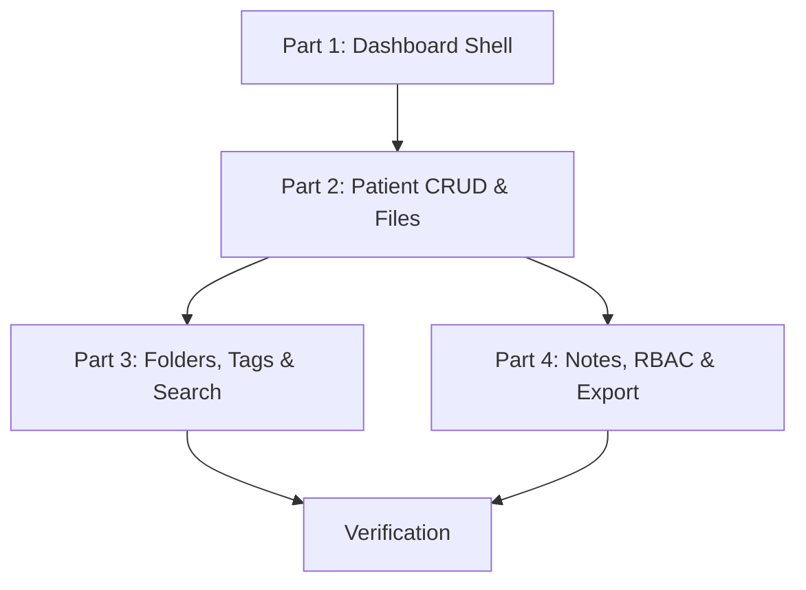

# Phase 3 Implementation Plan: Dashboard Features

> **Scope:** Blueprint Steps 5, 6, and 7
> **Depends on:** Phase 2 (Types, Schemas, DB, Auth) — ✅ COMPLETE
> **Generated:** 2026-03-18

---

## Requirements Restatement

Phase 3 transforms the empty dashboard shell into a fully functional patient management workspace. We are building all six dashboard features:

1. **Patient CRUD** — Create, read, update, delete patients with paginated listing
2. **File Upload** — Upload patient files to Supabase Storage with metadata tracking, free-tier enforcement (10 files)
3. **Folder System** — Hierarchical folder structure per-patient, move files between folders
4. **Tagging** — Tag-based file organization and filtering
5. **Full-Text Search** — Search across patient names and document file names
6. **Appointment Notes** — Per-patient timestamped note log with CRUD
7. **Role-Based Access** — Owner grants view/edit to receptionist/assistant staff
8. **ZIP Export** — One-click download of all patient files as a ZIP archive

---

## Risk Assessment

| Risk | Severity | Mitigation |
|------|----------|------------|
| **Supabase Storage misconfiguration** — Files uploaded but not downloadable, or accessible to wrong users | HIGH | Create `patient-files` bucket with strict RLS. Use signed URLs for downloads. Test upload → download round-trip. |
| **Free-tier bypass** — User uploads more than 10 files by racing multiple requests | MEDIUM | Enforce count check in the repository layer AND in RLS (defense in depth). Use serialized upload — disable multiselect for free tier. |
| **RLS cross-patient leak** — Staff member accesses a patient from a doctor they're not authorized for | HIGH | All repository methods require `ownerId`. The `get_patient_owner()` SQL function + `is_staff_for_owner()` enforce access at DB level. Test with mock cross-user scenarios. |
| **ZIP export memory pressure** — Large patient with many files causes OOM | MEDIUM | Stream files from Supabase Storage → JSZip → response stream. Set a max file count per export (e.g., 200 files). |
| **Search injection** — Malicious search queries exploiting ilike/FTS | LOW | Parameterized queries via Supabase client. Zod validation on search input (min 1 char, max 100 chars, no SQL metacharacters). |
| **File size validation** — Oversized file exhausts storage quota | MEDIUM | Client-side validation (MAX_FILE_SIZE_BYTES = 50 MB) + server-side Content-Length check before forwarding to Supabase Storage. |

---

## Architecture Decisions

### Repository Pattern
Every data access operation is encapsulated in a repository class (e.g. `PatientRepository`, `FileRepository`). Repositories accept a Supabase client instance and return typed `ApiResponse<T>` or `PaginatedResponse<T>` envelopes. This keeps API routes thin and logic testable.

### API Route Structure
```
app/api/
├── patients/
│   ├── route.ts            → GET (list), POST (create)
│   └── [id]/
│       ├── route.ts        → GET, PUT, DELETE
│       ├── files/
│       │   └── route.ts    → GET (list), POST (upload)
│       ├── folders/
│       │   └── route.ts    → GET (list), POST (create)
│       ├── notes/
│       │   └── route.ts    → GET (list), POST (create)
│       └── export/
│           └── route.ts    → POST (generate ZIP)
├── files/
│   ├── [id]/
│   │   └── route.ts        → GET (download URL), DELETE
│   └── search/
│       └── route.ts        → GET (search by name/tags)
├── folders/
│   └── [id]/
│       └── route.ts        → PUT (rename), DELETE
├── notes/
│   └── [id]/
│       └── route.ts        → PUT, DELETE
└── staff/
    ├── route.ts            → GET (list), POST (grant)
    └── [id]/
        └── route.ts        → DELETE (revoke)
```

### Component Hierarchy
```
app/(dashboard)/
├── layout.tsx               → Sidebar + TopBar shell
├── patients/
│   ├── page.tsx             → Patient list + search
│   ├── new/page.tsx         → Create patient form
│   └── [id]/page.tsx        → Patient detail (files, folders, notes)
└── settings/
    └── team/page.tsx        → Staff management

components/dashboard/
├── Sidebar.tsx              → Navigation sidebar
├── TopBar.tsx               → Header with search + user menu
├── PatientCard.tsx          → Patient list card
├── PatientForm.tsx          → Create/edit patient form
├── FileUploader.tsx         → Drag-and-drop file upload
├── FileList.tsx             → File grid/list view
├── FolderTree.tsx           → Folder hierarchy
├── TagInput.tsx             → Tag editor component
├── SearchBar.tsx            → Debounced search input
├── NotesList.tsx            → Timestamped note log
├── NoteEditor.tsx           → Add/edit note form
├── StaffManager.tsx         → Team access management
└── ExportButton.tsx         → ZIP export trigger
```

---

## Implementation Steps

### Part 1: Dashboard Layout & Shell (~1.5 hours)

Build the dashboard chrome FIRST so every subsequent page renders inside a proper layout.

1. **Create `components/dashboard/Sidebar.tsx`**
   - Nav links: Patients, Analytics, Settings
   - Active state highlighting based on current route
   - Collapsible on mobile (sheet/drawer pattern from shadcn)
   - User avatar + display name at bottom
   - Logout button

2. **Create `components/dashboard/TopBar.tsx`**
   - App logo/name on left
   - Global search input (placeholder — wired in Part 3)
   - User dropdown menu on right (profile link, logout)

3. **Update `app/(dashboard)/layout.tsx`**
   - Fetch session/user server-side
   - Render Sidebar + TopBar + `{children}` content area
   - Session redirect if not authenticated (defense in depth, middleware already covers this)

4. **Create shared UI components**
   - `components/ui/LoadingState.tsx` — skeleton loaders
   - `components/ui/EmptyState.tsx` — illustrated empty state with action CTA

5. **Write tests**
   - Sidebar renders navigation links
   - TopBar renders search and user menu
   - Layout renders children

### Part 2: Patient CRUD & File Upload — Blueprint Step 5 (~3 hours)

**Repositories:**

6. **Create `lib/repositories/patient.repository.ts`**
   - `findAll(ownerId, page, limit, search?)` → `PaginatedResponse<Patient>`
   - `findById(patientId, ownerId)` → `ApiResponse<Patient>`
   - `create(data: CreatePatientInput, ownerId)` → `ApiResponse<Patient>`
   - `update(patientId, data: UpdatePatientInput, ownerId)` → `ApiResponse<Patient>`
   - `delete(patientId, ownerId)` → `ApiResponse<null>`
   - All methods use the Supabase client; RLS enforces access

7. **Create `lib/repositories/file.repository.ts`**
   - `upload(file: File, patientId, ownerId, folderId?, tags?)` → `ApiResponse<PatientFile>`
     - Uploads to Supabase Storage bucket `patient-files` under `{ownerId}/{patientId}/{fileName}`
     - Creates record in `patient_files` table
   - `findByPatient(patientId, ownerId, folderId?)` → list files
   - `delete(fileId, ownerId)` → removes from storage + DB
   - `getSignedUrl(fileId, ownerId)` → 1-hour signed download URL
   - `countByOwner(ownerId)` → total file count for tier enforcement

8. **Write tests FIRST (TDD)**
   - `lib/repositories/__tests__/patient.test.ts`
     - findAll returns paginated patients
     - findById returns single patient
     - create validates input and inserts
     - update validates and patches
     - delete removes patient
   - `lib/repositories/__tests__/file.test.ts`
     - upload creates storage entry + DB record
     - findByPatient filters correctly
     - delete removes from storage and DB
     - countByOwner returns accurate total
     - tier enforcement blocks upload at limit

**API Routes:**

9. **Create `app/api/patients/route.ts`** — GET (paginated list), POST (create)
   - GET: parse `page`, `limit`, `search` query params, call repository
   - POST: validate body with `createPatientSchema`, call repository

10. **Create `app/api/patients/[id]/route.ts`** — GET, PUT, DELETE
    - Auth check on every method
    - PUT validates with `updatePatientSchema`

11. **Create `app/api/patients/[id]/files/route.ts`** — GET (list files), POST (upload)
    - POST: multipart form data handling
    - Tier check before upload (free = max 10 files)
    - Validate with `uploadFileSchema`

12. **Create `app/api/files/[id]/route.ts`** — GET (signed URL), DELETE

**Pages & Components:**

13. **Create `components/dashboard/PatientCard.tsx`**
    - Displays patient name, date of birth, phone, file count
    - Link to patient detail page
    - Edit/Delete actions dropdown

14. **Create `components/dashboard/PatientForm.tsx`**
    - Reusable form for create and edit
    - Zod validation with react-hook-form
    - Fields: first name, last name, DOB (optional), gender, phone, email

15. **Create `components/dashboard/FileUploader.tsx`**
    - Drag-and-drop zone + click-to-browse
    - Shows upload progress
    - Validates file size (50 MB max) and count (tier check)
    - Accepts common medical file types (PDF, JPG, PNG, DICOM)

16. **Create `components/dashboard/FileList.tsx`**
    - Grid or list view toggle
    - Each file shows: name, size, type icon, upload date, tags
    - Actions: download, delete, move to folder, edit tags

17. **Update `app/(dashboard)/patients/page.tsx`**
    - Patient list with search bar
    - "Add Patient" button
    - Pagination controls
    - Empty state when no patients

18. **Create `app/(dashboard)/patients/new/page.tsx`**
    - PatientForm in create mode

19. **Create `app/(dashboard)/patients/[id]/page.tsx`**
    - Patient header (name, details, edit button)
    - Tabs: Files | Notes
    - Files tab: FileUploader + FileList
    - Notes tab: placeholder (built in Part 4)

### Part 3: Folders, Tags & Search — Blueprint Step 6 (~2.5 hours)

**Repositories:**

20. **Create `lib/repositories/folder.repository.ts`**
    - `findByPatient(patientId, ownerId)` → flat list of folders
    - `create(name, patientId, parentId?)` → new folder
    - `rename(folderId, newName, ownerId)` → updated folder
    - `delete(folderId, ownerId)` → delete folder, move files to root (folder_id = NULL)

21. **Update `lib/repositories/file.repository.ts`**
    - Add `moveToFolder(fileId, folderId, ownerId)`
    - Add `addTags(fileId, tags, ownerId)` / `removeTags(fileId, tags, ownerId)`
    - Add `searchByName(query, ownerId)` → ilike search on file_name
    - Add `filterByTags(tags, ownerId)` → `&& tags` array overlap

22. **Create Zod schemas for folders/search**
    - `lib/schemas/folder.schema.ts` — `createFolderSchema`, `renameFolderSchema`
    - `lib/schemas/search.schema.ts` — `searchQuerySchema` (min 1, max 100 chars)

23. **Write tests FIRST (TDD)**
    - Folder repository CRUD
    - File move, tag add/remove, search, filter
    - Zod validation for folder and search schemas

**API Routes:**

24. **Create `app/api/patients/[id]/folders/route.ts`** — GET, POST
25. **Create `app/api/folders/[id]/route.ts`** — PUT (rename), DELETE
26. **Create `app/api/files/search/route.ts`** — GET with `q` and `tags` query params

**Components:**

27. **Create `components/dashboard/FolderTree.tsx`**
    - Shows folder hierarchy for a patient
    - Click folder to filter file list
    - Right-click or dropdown: rename, delete
    - "New Folder" button

28. **Create `components/dashboard/TagInput.tsx`**
    - Pills/badges for existing tags
    - Input to add new tags (Enter to confirm)
    - Click 'x' to remove tag
    - Auto-suggest existing tags from the patient's file set

29. **Create `components/dashboard/SearchBar.tsx`**
    - Debounced input (300ms)
    - Displays results as file cards
    - Tag filter chips

30. **Update `app/(dashboard)/patients/[id]/page.tsx`**
    - Add FolderTree sidebar within Files tab
    - File list filtered by selected folder
    - TagInput on file detail/dialog

### Part 4: Appointment Notes, RBAC & ZIP Export — Blueprint Step 7 (~3 hours)

**Repositories:**

31. **Create `lib/repositories/note.repository.ts`**
    - `findByPatient(patientId, ownerId)` → notes sorted by createdAt DESC
    - `create(patientId, content, authorId)` → new note
    - `update(noteId, content, authorId)` → edit note
    - `delete(noteId, authorId)` → remove note

32. **Create `lib/repositories/staff.repository.ts`**
    - `grantAccess(ownerId, staffEmail, role, permissions)` → invite staff
      - Looks up user by email, inserts into `staff_access`
    - `revokeAccess(ownerId, staffAccessId)` → removes access
    - `listStaff(ownerId)` → all staff entries
    - `getAccessLevel(userId, ownerId)` → `{ role, permissions } | null`

33. **Create `lib/services/export.service.ts`**
    - `exportPatientFiles(patientId, ownerId, supabase)` → generates ZIP
      - Fetches all file records for the patient
      - Downloads each file from Supabase Storage via signed URL
      - Adds to JSZip archive, returns as `Blob` (client-side) or buffer (API)

34. **Create Zod schemas**
    - `lib/schemas/staff.schema.ts` — `grantStaffSchema` (email, role, permissions)

35. **Write tests FIRST (TDD)**
    - Note repository: CRUD
    - Staff repository: grant, revoke, list, access check
    - Export service: ZIP generation with mocked file downloads
    - RBAC enforcement: test that staff with 'view' can't edit, staff with no access can't see
    - **100% coverage on RBAC logic**

**API Routes:**

36. **Create `app/api/patients/[id]/notes/route.ts`** — GET, POST
37. **Create `app/api/notes/[id]/route.ts`** — PUT, DELETE
38. **Create `app/api/staff/route.ts`** — GET (list), POST (grant)
39. **Create `app/api/staff/[id]/route.ts`** — DELETE (revoke)
40. **Create `app/api/patients/[id]/export/route.ts`** — POST (stream ZIP)

**Components:**

41. **Create `components/dashboard/NotesList.tsx`**
    - Chronological feed of notes (newest first)
    - Each note shows: content, author name, timestamp
    - Edit/Delete actions (author only — or owner)

42. **Create `components/dashboard/NoteEditor.tsx`**
    - Textarea + submit button
    - Inline editing mode for existing notes
    - Zod validation on content

43. **Create `components/dashboard/StaffManager.tsx`**
    - List current staff (name, role, permissions)
    - "Invite Staff" form: email, role dropdown, permission toggle
    - Revoke access button with confirmation dialog

44. **Create `components/dashboard/ExportButton.tsx`**
    - Single button "Export All Files"
    - Shows progress spinner while generating
    - Triggers browser download when ready

45. **Update `app/(dashboard)/patients/[id]/page.tsx`**
    - Notes tab: NotesList + NoteEditor
    - Export button in patient header

46. **Create `app/(dashboard)/settings/team/page.tsx`**
    - StaffManager component
    - Tier check: only 'clinic' tier can add staff

---

## Dependency Graph (Phase 3 Internal)



Parts 3 and 4 can be built in parallel after Part 2 — they share the patient detail page but operate on independent data tables.

---

## Files Created or Modified (Summary)

### New Files (~30 files)

| Category | Files |
|----------|-------|
| **Repositories** | `patient.repository.ts`, `file.repository.ts`, `folder.repository.ts`, `note.repository.ts`, `staff.repository.ts` |
| **Services** | `export.service.ts` |
| **Schemas** | `folder.schema.ts`, `search.schema.ts`, `staff.schema.ts` |
| **API Routes** | 12 route files across `/patients`, `/files`, `/folders`, `/notes`, `/staff` |
| **Pages** | `patients/page.tsx`, `patients/new/page.tsx`, `patients/[id]/page.tsx`, `settings/team/page.tsx` |
| **Components** | `Sidebar.tsx`, `TopBar.tsx`, `PatientCard.tsx`, `PatientForm.tsx`, `FileUploader.tsx`, `FileList.tsx`, `FolderTree.tsx`, `TagInput.tsx`, `SearchBar.tsx`, `NotesList.tsx`, `NoteEditor.tsx`, `StaffManager.tsx`, `ExportButton.tsx`, `LoadingState.tsx`, `EmptyState.tsx` |
| **Tests** | `patient.test.ts`, `file.test.ts`, `folder.test.ts`, `note.test.ts`, `staff.test.ts`, `export.test.ts` |

### Modified Files

| File | Change |
|------|--------|
| `app/(dashboard)/layout.tsx` | Full layout with Sidebar + TopBar |
| `app/(dashboard)/patients/page.tsx` | Replace stub with real patient list |
| `lib/repositories/file.repository.ts` | Add folder move, tag ops, search methods (Part 3) |

---

## Verification Commands (Run After Each Part)

```bash
# Quick check (after each part)
npx tsc --noEmit
npm run lint
npm test -- --run

# Full verification (after all parts complete)
npx tsc --noEmit
npm run build
npm run lint
npm test -- --run --coverage
```

## Exit Criteria (Phase 3 Complete)

- [ ] **Patients** — CRUD operations work end-to-end
- [ ] **Files** — Upload, list, download (signed URL), delete per patient
- [ ] **Folders** — Create, rename, delete folders; move files between folders
- [ ] **Tags** — Add/remove tags on files; filter files by tag
- [ ] **Search** — Full-text search across patient names and file names
- [ ] **Notes** — Create, list, edit, delete appointment notes per patient
- [ ] **RBAC** — Owner grants view/edit to staff; staff sees only authorized patients
- [ ] **ZIP Export** — One-click download of all patient files
- [ ] **Free tier** — Upload blocked at 10 files with clear error
- [ ] **Build** — `npm run build` succeeds
- [ ] **Types** — `npx tsc --noEmit` zero errors
- [ ] **Lint** — `npm run lint` zero errors/warnings
- [ ] **Tests** — All pass, 80%+ overall coverage, 100% on RBAC logic
- [ ] **Security** — Zod validation on every API input, no `any` types, no `console.log`

---

## Estimated Complexity: **HIGH**

| Component | Estimate |
|-----------|----------|
| Dashboard shell (Part 1) | ~1.5 hours |
| Patient CRUD & files (Part 2) | ~3 hours |
| Folders, tags, search (Part 3) | ~2.5 hours |
| Notes, RBAC, export (Part 4) | ~3 hours |
| Testing + verification | ~2 hours |
| **Total** | **~12 hours** |

---

**WAITING FOR CONFIRMATION**: Proceed with this plan? (yes / no / modify)
